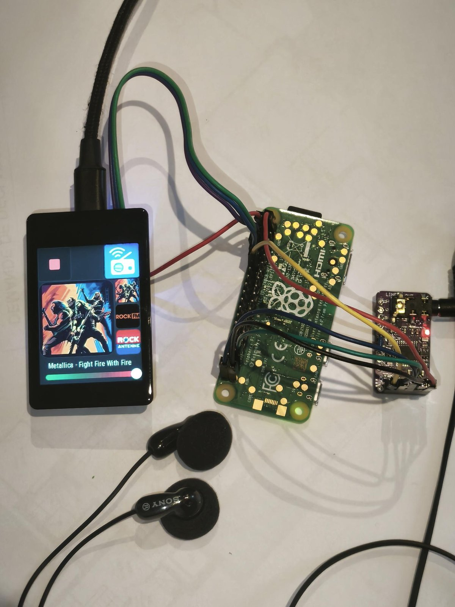
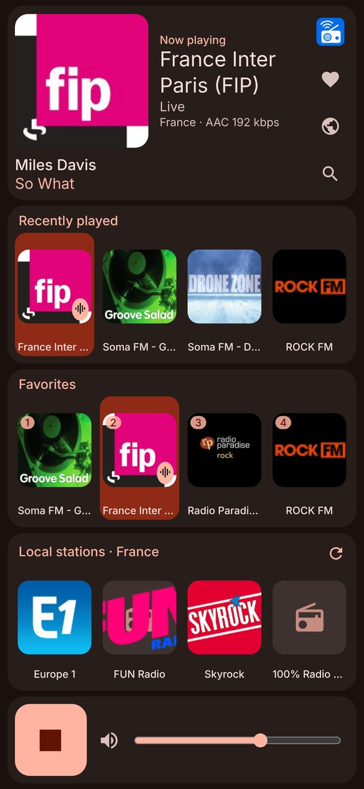
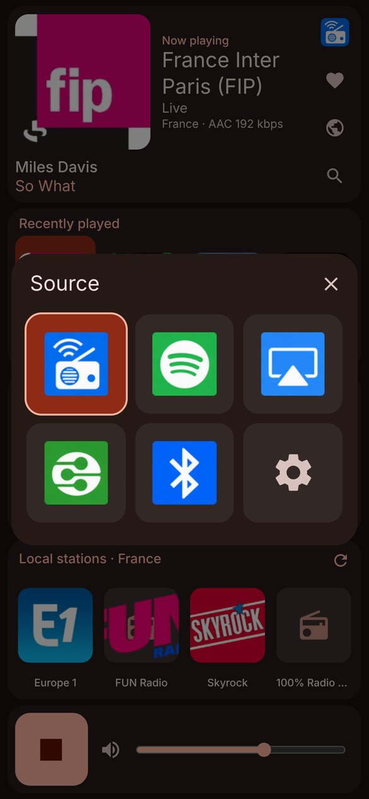
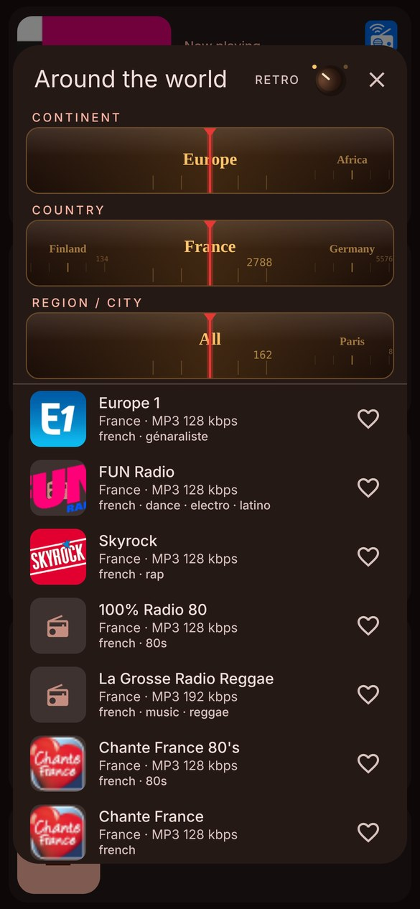
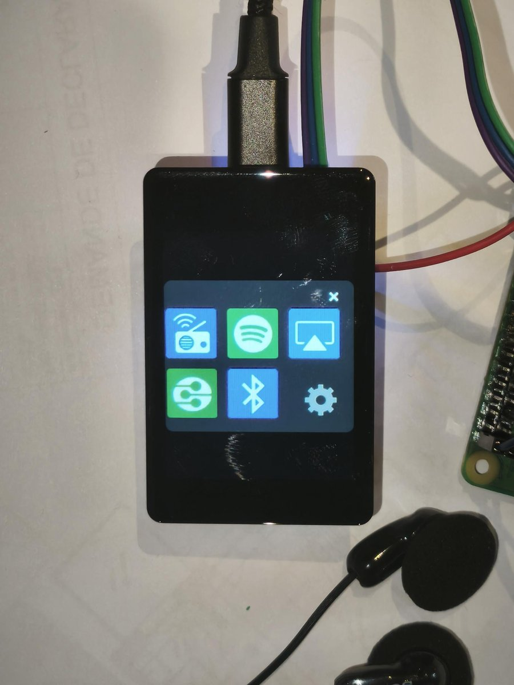

# Raspberry Streamer

**A touch-screen network audio streamer built from three off-the-shelf boards:**
a Raspberry Pi Zero 2 W running [moOde audio](https://moodeaudio.org), a PCM5102 I2S DAC,
and a Waveshare ESP32-S3 touch display running [Tasmota](https://tasmota.github.io) / Berry / HASPmota.
Your phone becomes the main remote, through a web app served by the ESP32 itself.

<p align="center">
  
</p>

> Status: working prototype, no enclosure yet. A few short wires, a few solder joints, no custom PCB.

## Features

- 📻 **Web radio**: 50,000+ stations from [Radio Browser](https://www.radio-browser.info). Search, local stations, favorites (20), history, and an "Around the world" tuner by continent, country and city.
- 🎵 **Spotify Connect, AirPlay (1 or 2), Bluetooth and DLNA/UPnP**: all moOde renderers, switched from the screen or the phone. Track info is shown when the source sends it.
- 🗂️ **DLNA browser**: find the media servers on your network, browse folders and play from any track. Loop, shuffle and single-track modes.
- 🖐️ **Touch screen (240×320)**: cover art, the last 3 stations, source picker, volume, boot progress gauge, Wi-Fi status.
- 📱 **Phone web app** at `http://<esp-ip>/ui`, no app to install. Track art comes from MusicBrainz, Cover Art Archive or iTunes.
- 🔊 **One volume everywhere**: the screen slider also drives the source device's volume (AirPlay via DACP, Bluetooth).
- 🔁 **moOde library sync**: stations played from the phone are added to moOde's Radio library, logo included.
- 📶 **Wi-Fi sync**: the Pi joins the ESP's Wi-Fi network automatically. Wi-Fi is set up once, in Tasmota.

## Screenshots

| Phone: now playing | Phone: source | Phone: around the world | Touch screen: source |
|---|---|---|---|
|  |  |  |  |

## How it works

```
 Phone (browser)                 Waveshare ESP32-S3 touch LCD 2"           Raspberry Pi Zero 2 W
 ┌──────────────┐  HTTP /ui     ┌──────────────────────────────┐  UART    ┌───────────────────────┐  I2S   ┌─────────┐
 │  web app     │ ────────────▶ │ Tasmota + Berry + HASPmota   │ ◀──────▶ │ moOde (MPD, shairport,│ ─────▶ │ PCM5102 │──▶ amp / headphones
 │  (Radio      │               │ touch UI, web server, API    │ 115200   │ librespot, bluealsa,  │        │  DAC    │
 │   Browser)   │ ──── DLNA API (port 8091) ─────────────────────────────▶ │ upmpdcli) + espbridge │        └─────────┘
 └──────────────┘                └──────────────────────────────┘          └───────────────────────┘
```

- **ESP32-S3**: the user interface and the "brain" of the remote. It runs the touch UI (HASPmota), serves the phone web app and talks to the Pi over a serial link.
- **Raspberry Pi**: plays the audio. moOde handles every source. A small Python service, `espbridge`, translates serial commands (`PLAY`, `VOL`, `STOP`…) into moOde/MPD actions and reports playback status back to the screen.

## Hardware

| Part | Notes | Approx. price |
|---|---|---|
| Raspberry Pi Zero 2 W | with a soldered GPIO header | ~€20 |
| PCM5102A I2S DAC board ("GY-PCM5102") | line out, 3.5 mm jack | ~€5 |
| Waveshare ESP32-S3-Touch-LCD-2 | 2" 240×320 capacitive touch, PSRAM | ~€20 |
| microSD card (8 GB+), USB-C power supply 5 V / 2 A, Dupont wires | | |

Wiring takes about 10 wires. See [docs/INSTALL.md](docs/INSTALL.md#2-wiring).

## Getting started

The full step-by-step guide is in **[docs/INSTALL.md](docs/INSTALL.md)**:

1. Flash moOde with Raspberry Pi Imager (**set the username, password and SSH there**)
2. Wire the DAC and the serial link
3. Configure moOde: DAC, **install AirPlay and Spotify** (not installed by default), enable the renderers
4. Install the `espbridge` service on the Pi
5. Flash Tasmota (LVGL build) on the ESP32-S3 and upload the `esp/` files
6. Open `http://<esp-ip>/ui` on your phone

## Repository layout

| Folder | Content |
|---|---|
| `esp/` | Tasmota filesystem: Berry scripts (`*.be`), HASPmota layout (`pages.jsonl`), display config, icons (`A/`) |
| `esp/ui/` | Phone web app (`/ui`): HTML/CSS/JS + its Berry driver `ui.be` |
| `pi/` | `espbridge` Python service (`/opt/espbridge`) and its systemd unit |
| `tools/` | `tasmota_sync.py` and `pi_sync.py`: deploy from a PC, read logs |
| `docs/` | Installation guide, [serial protocol and development notes](docs/DEVELOPMENT.md), images |

## Roadmap

- 3D-printed enclosure
- Power amplifier stage, controlled by a GPIO (power off with the stop button)
- Low-power standby for the Pi
- Bluetooth pairing code shown on the screen
- External audio input

## Credits

Built on [moOde audio](https://moodeaudio.org), [Tasmota](https://github.com/arendst/Tasmota) (Berry, LVGL, HASPmota)
and the [Radio Browser](https://www.radio-browser.info) community database.
Station logos shown in the screenshots belong to their respective owners.

## License

[MIT](LICENSE)
