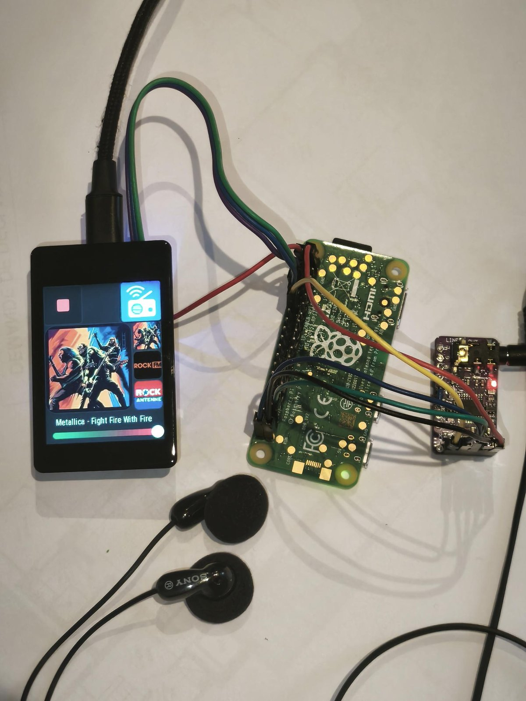

# Installation guide

About one hour from a blank SD card to music. You need a computer on the same network
and the parts listed in the [README](../README.md#hardware). **No soldering** if the Pi and the DAC
come with their pin headers already soldered.

1. [Flash moOde on the Pi](#1-flash-moode-on-the-pi)
2. [Wiring](#2-wiring)
3. [Configure moOde](#3-configure-moode)
4. [Enable the Pi serial port](#4-enable-the-pi-serial-port)
5. [Install the espbridge service](#5-install-the-espbridge-service)
6. [Flash and set up the ESP32-S3](#6-flash-and-set-up-the-esp32-s3)
7. [First start](#7-first-start)
8. [Troubleshooting](#8-troubleshooting)

---

## 1. Flash moOde on the Pi

Use **[Raspberry Pi Imager](https://www.raspberrypi.com/software/)**:

1. **Device**: Raspberry Pi Zero 2 W.
2. **OS**: *Media player OS → moOde audio player* (or *Use custom* with the image downloaded from [moodeaudio.org](https://moodeaudio.org)).
3. When Imager asks **"Would you like to apply OS customisation settings?"**, choose **Edit settings**. ⚠️ **This step is required**: moOde has no default user, so without it you cannot log in over SSH.
   - **General** tab:
     - Hostname: e.g. `moode`
     - **Username and password**: choose your own (for example `pi` / a strong password). You will use them for SSH.
     - **Wireless LAN**: your Wi-Fi SSID and password, and the country.
     - Locale: your time zone.
   - **Services** tab: **Enable SSH** (password authentication is fine to start with).
4. Write the card, put it in the Pi, but don't power it yet: wire it first.

> Forgot the username or password later? Reflash the card with new customisation settings. There is no other way to recover them on moOde.

## 2. Wiring

Dupont wires only. Buy the Pi Zero 2 **WH** (header pre-soldered) and a PCM5102 board with its pins
soldered, otherwise solder the headers first.

### Pi ⇄ ESP32-S3 (serial link)

| Raspberry Pi (header pin) | ESP32-S3 Waveshare | Function |
|---|---|---|
| GPIO14 / TXD (pin 8) | GPIO20 (RX) | Pi → ESP |
| GPIO15 / RXD (pin 10) | GPIO19 (TX) | ESP → Pi |
| GND (pin 6) | GND | common ground |
| 5V (pin 2) | 5V | power: the whole streamer is powered from the screen's USB-C |

Both sides use 3.3 V logic: connect them directly, no level shifter needed. The ESP pins are set
in [`esp/pizero_uart.be`](../esp/pizero_uart.be) (`serial(20, 19, 115200)`). Change them there if you wire differently.

### Pi ⇄ PCM5102 DAC (I2S)

| Raspberry Pi (header pin) | PCM5102 board |
|---|---|
| 5V (pin 4) | VIN |
| GND (pin 14) | GND |
| GPIO18 / PCM_CLK (pin 12) | BCK |
| GPIO19 / PCM_FS (pin 35) | LCK (LRCK) |
| GPIO21 / PCM_DOUT (pin 40) | DIN |

SCK is not connected: the DAC generates its own clock. Nothing to configure on the DAC board.

<p align="center"></p>

## 3. Configure moOde

Power the streamer, wait 2–3 minutes for the first boot, then open **`http://moode.local`**
(or the Pi's IP address) in a browser.

1. **Configure → Audio → Output device**: choose the I2S device **"HiFiBerry DAC"**
   (a.k.a. *Generic-1 I2S (hifiberry-dac)*, the PCM5102 driver). Reboot when moOde asks.
2. **AirPlay and Spotify Connect are not installed by default** on current moOde images.
   Install them from moOde's web UI first, then turn them on in **Configure → Renderers**.
3. In **Configure → Renderers**, also turn on:
   - **Bluetooth** (and its pairing agent),
   - **UPnP/DLNA renderer**. Give it a name, e.g. `TasmoOde Receiver`.
4. Optional: **Configure → System → Hostname / Wi-Fi**, if you did not set them in Imager.

## 4. Enable the Pi serial port

Log in over SSH with the **username and password you chose in Imager**:

```sh
ssh <user>@moode.local
```

Enable the hardware UART and free it from the Linux console:

```sh
sudo raspi-config        # Interface Options → Serial Port
                         #   login shell over serial? → No
                         #   serial port hardware enabled? → Yes
sudo reboot
```

Without `raspi-config`, do it by hand: add `enable_uart=1` to `/boot/firmware/config.txt`,
and remove `console=serial0,115200` from `/boot/firmware/cmdline.txt`. Then reboot.

Check: `ls -l /dev/serial0` must exist.

## 5. Install the espbridge service

On the Pi:

```sh
sudo apt update
sudo apt install -y git python3-serial python3-pil
git clone https://github.com/rkroman-86/raspberry-streamer.git
cd raspberry-streamer
sudo mkdir -p /opt/espbridge
sudo install -m 644 pi/espbridge/*.py /opt/espbridge/
sudo install -m 644 pi/systemd/espbridge.service /etc/systemd/system/
sudo systemctl daemon-reload
sudo systemctl enable --now espbridge
systemctl status espbridge          # should be "active (running)"
```

Logs: `sudo journalctl -u espbridge -f`.

## 6. Flash and set up the ESP32-S3

1. Flash Tasmota with the **[Tasmota Web Installer](https://tasmota.github.io/install/)** (Chrome or Edge, USB cable),
   choosing the **LVGL build for ESP32-S3** (`tasmota32s3-lvgl`). It includes Berry, LVGL and HASPmota.
2. Connect to the `tasmota-xxxx` Wi-Fi access point, enter **the same Wi-Fi network as the Pi**,
   and note the IP address the ESP gets. A fixed IP or DHCP reservation in your router is recommended.
3. Upload the files of the `esp/` folder to the ESP filesystem, **keeping the folder structure**
   (`/A/*.png`, `/ui/*`, the `.be` files, `pages.jsonl` and `display.ini` at the root).
   - Easy way, from any computer with Python 3 (standard library only):
     ```sh
     python tools/tasmota_sync.py --host <esp-ip> push --all
     python tools/tasmota_sync.py --host <esp-ip> cmd "Restart 1"
     ```
   - Or by hand: Tasmota web UI → *Tools → Manage File System*.
4. After the restart, the screen shows the player. `display.ini` sets up the ST7789 display and the CST816 touch controller,
   and `autoexec.be` starts the program.

## 7. First start

- The screen shows a **boot gauge** while moOde starts, then the player.
- Open **`http://<esp-ip>/ui`** on your phone and add it to the home screen. That's the main remote.
- **`http://<esp-ip>/wsync`**: Wi-Fi sync with the Pi, and AirPlay version (AirPlay 2 by default; choose 1 for old iPads/iPhones).
- If the Pi is on another Wi-Fi network, the ESP sends it its own network credentials, and the Pi switches to that network.
- On the screen, the **Sources** button (top right) picks Web radio, Spotify, AirPlay, DLNA or Bluetooth.
- Spotify, AirPlay and Bluetooth are then started from your phone. The streamer appears under moOde's renderer names.

## 8. Troubleshooting

| Symptom | Check |
|---|---|
| Screen stuck on the boot gauge | `systemctl status espbridge` on the Pi. TX/RX swapped? Is the serial console still enabled (step 4)? |
| `ssh: Permission denied` | Use the username/password set in Imager (step 1.3). If unknown, reflash. |
| No sound | Output device in moOde (step 3.1), I2S wires BCK / LCK / DIN, DAC powered (VIN, GND). |
| Streamer not listed in Spotify / AirPlay on the phone | Install the renderers in moOde (step 3.2) and turn them on. Spotify Connect needs Premium. |
| Old iPad gets no AirPlay audio | Set AirPlay 1 at `http://<esp-ip>/wsync`. |
| ESP console | `python tools/tasmota_sync.py --host <esp-ip> log -f` |

Development workflow, serial protocol and internals: [DEVELOPMENT.md](DEVELOPMENT.md).
